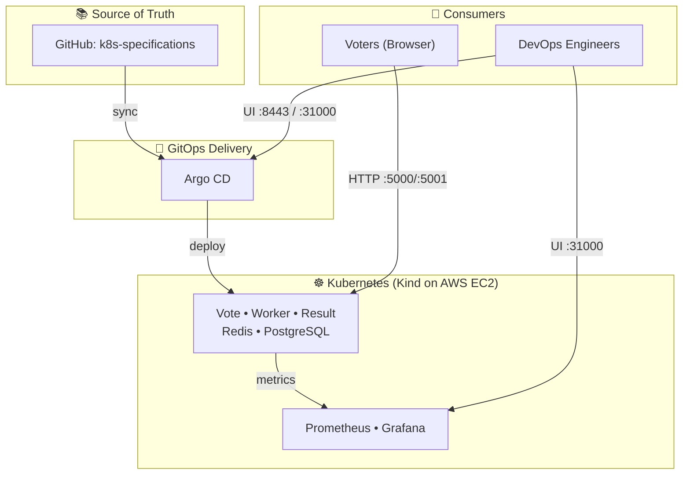
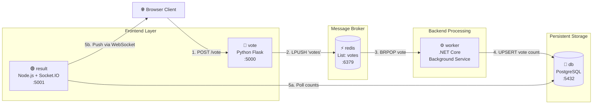
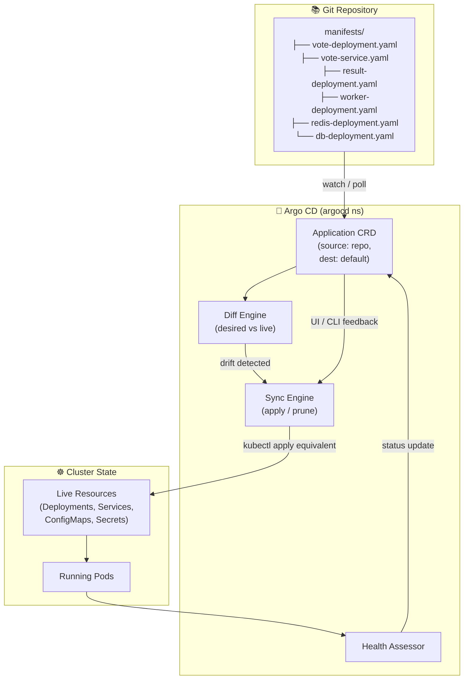
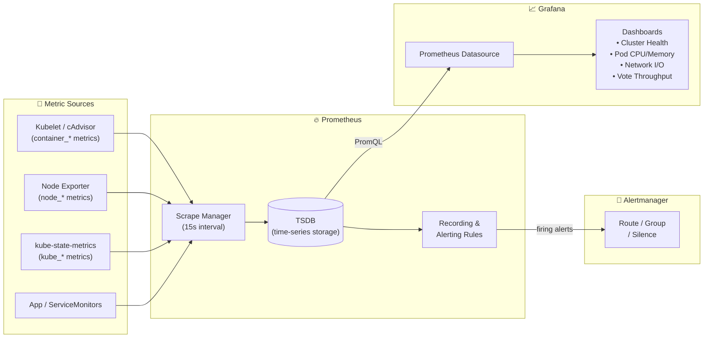
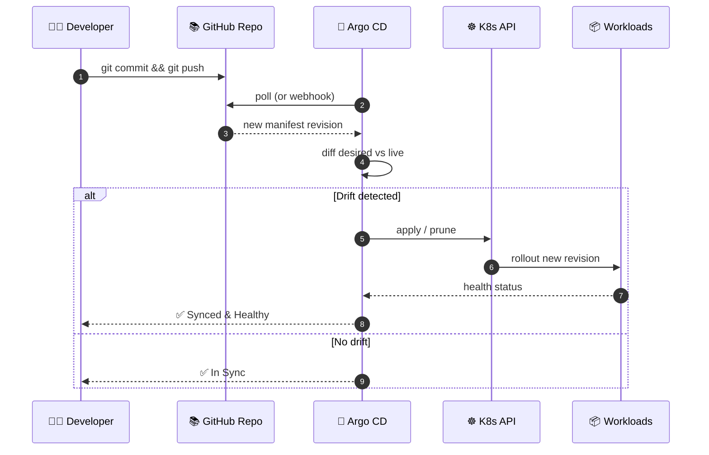

# Cloud-Native Microservices Deployment with Kubernetes, GitOps & Observability

[](https://kubernetes.io/)
[](https://argoproj.github.io/cd/)
[](https://prometheus.io/)
[](https://grafana.com/)
[](https://aws.amazon.com/ec2/)
[](https://helm.sh/)
[](https://www.docker.com/)

An enterprise-ready **GitOps** deployment of a distributed microservices voting application running on a **multi-node Kubernetes cluster (Kind) on AWS EC2**, with fully automated declarative continuous delivery via **Argo CD** and end-to-end observability using the **kube-prometheus-stack (Prometheus + Grafana)**.

---

## 📑 Table of Contents
- [Architecture Overview](#-architecture-overview)
- [High-Level Design (HLD)](#️-high-level-design-hld)
- [Low-Level Design (LLD)](#-low-level-design-lld)
- [GitOps Workflow](#-gitops-workflow)
- [Key Features](#-key-features)
- [Repository Structure](#-repository-structure)
- [Step-by-Step Setup](#️-step-by-step-setup-guide)
- [PromQL Monitoring Queries](#-promql-monitoring-queries)
- [Troubleshooting](#-troubleshooting)
- [Resume / Portfolio Summary](#-resume--portfolio-description)
- [Author](#-author)

---

## 🧭 Architecture Overview

This project demonstrates a **production-style deployment topology** where:

| Layer | Component | Responsibility |
| :--- | :--- | :--- |
| **Source of Truth** | GitHub (`k8s-specifications`) | Declarative manifests for all microservices |
| **Delivery** | Argo CD | Continuous reconciliation, drift detection, self-healing |
| **Compute** | AWS EC2 + Kind (3 nodes) | 1 control-plane node + 2 worker nodes |
| **Application** | Vote / Worker / Result / Redis / PostgreSQL | Polyglot microservices pipeline |
| **Observability** | Prometheus + Grafana + Node Exporter | Metrics scraping, dashboards, alerting |

---

## 🏛️ High-Level Design (HLD)

The HLD captures the **full end-to-end flow**: developer push → GitOps sync → cluster reconciliation → user traffic → telemetry.



**HLD highlights:**
- **Single source of truth** (GitHub) drives the entire cluster state — no manual `kubectl apply`.
- **Argo CD** lives inside the cluster as the reconciliation engine (pull-based GitOps).
- **Kind** emulates a 3-node enterprise topology on a single EC2 instance.
- **Observability stack** runs in an isolated `monitoring` namespace, scraping both app and node metrics.

---

## 🔬 Low-Level Design (LLD)

The LLD is split into **three pipelines**: the **application data flow** (user vote → database → live result), the **GitOps reconciliation flow**, and the **telemetry flow** (metrics → scrape → dashboard).

### LLD 1 — Application Data Pipeline



**Design notes:**
- **Redis** acts as a **decoupling buffer** — the vote endpoint stays responsive under burst load.
- **Worker** is horizontally scalable — multiple replicas can drain the queue in parallel.
- **Result** uses **WebSocket (Socket.IO)** for live-updating charts, backed by periodic DB reads.

---

### LLD 2 — Kubernetes Resource & GitOps Flow



**Design notes:**
- Argo CD continuously **diffs** the Git state against the live cluster.
- **Auto-sync + self-heal** re-applies manifests if someone manually edits a resource.
- **Prune** deletes resources removed from Git — keeping the cluster in lockstep with the repo.

---

### LLD 3 — Observability & Telemetry Pipeline



**Design notes:**
- **cAdvisor** exposes per-container CPU/memory/network metrics consumed by Prometheus.
- **kube-state-metrics** exposes cluster object health (desired vs ready replicas, restarts, etc.).
- **Alertmanager** is included via the `kube-prometheus-stack` Helm chart — wire it to Slack/email for production use.

---

## 🔁 GitOps Workflow



---

## 🚀 Key Features & Highlights

1. **Declarative GitOps with Argo CD**
   - Zero manual `kubectl apply` in production — GitHub is the single source of truth.
   - Automated **self-healing** and **drift detection** against manual cluster edits.
   - Auto-sync + prune keeps the cluster in exact lockstep with the repo.

2. **Distributed Polyglot Microservices Pipeline**
   - **Python (Flask)** front-end → **Redis** queue → **.NET Core** worker → **PostgreSQL** → **Node.js (Socket.IO)** real-time results.
   - Demonstrates service decoupling, async processing, and WebSocket push.

3. **Multi-Node Kubernetes (Kind) on AWS**
   - Emulates a 3-node enterprise cluster (1 control plane + 2 workers) on a single EC2 instance.
   - Reproducible, lightweight, and cost-effective.

4. **Production-Grade Observability**
   - Deployed via **Helm** using the official `kube-prometheus-stack`.
   - Real-time Prometheus scraping across pods, nodes, and containers.
   - Custom Grafana dashboards for CPU, memory, network I/O, and pod health.

---

## 📂 Repository Structure

```
.
├── kind-cluster/
│   ├── config.yml                 # Kind 3-node cluster config
│   ├── install_kind.sh            # Kind installer
│   └── install_kubectl.sh         # Kubectl installer
├── k8s-specifications/            # (Argo CD source of truth)
│   ├── vote-deployment.yaml
│   ├── vote-service.yaml
│   ├── result-deployment.yaml
│   ├── result-service.yaml
│   ├── worker-deployment.yaml
│   ├── redis-deployment.yaml
│   ├── redis-service.yaml
│   ├── db-deployment.yaml
│   ├── db-service.yaml
│   └── argocd-application.yaml    # Argo CD Application CRD
├── monitoring/
│   ├── prometheus-values.yaml     # (optional) Helm overrides
│   └── grafana-dashboards/        # Exported dashboard JSONs
└── README.md
```

---

## 🛠️ Step-by-Step Setup Guide

### 1. Prerequisites & EC2 Setup
- **Instance:** AWS EC2 `c7i-flex.large` (4 GB) or `m7i-flex.large` (8 GB), 30 GB gp3.
- **Security Group Ingress:** `22` (SSH), `5000` (Vote), `5001` (Result), `8443` (Argo CD), `9090` (Prometheus), `31000` (Grafana).

### 2. Install Docker, Kind & Kubectl
```bash
sudo apt update && sudo apt install -y docker.io
sudo usermod -aG docker $USER && newgrp docker

./kind-cluster/install_kind.sh
./kind-cluster/install_kubectl.sh
```

### 3. Launch 3-Node Kind Cluster
```bash
kind create cluster --config=kind-cluster/config.yml
kubectl get nodes
```

### 4. Install & Configure Argo CD
```bash
kubectl create namespace argocd
kubectl apply -n argocd -f https://raw.githubusercontent.com/argoproj/argo-cd/stable/manifests/install.yaml

kubectl wait --for=condition=ready pod -l app.kubernetes.io/name=argocd-server -n argocd --timeout=300s
kubectl get secret -n argocd argocd-initial-admin-secret -o jsonpath="{.data.password}" | base64 -d && echo

kubectl port-forward -n argocd service/argocd-server 8443:443 --address=0.0.0.0 &
```

### 5. Register the Argo CD Application
```bash
kubectl apply -f k8s-specifications/argocd-application.yaml
```

### 6. Deploy Observability Stack
```bash
curl -fsSL -o get_helm.sh https://raw.githubusercontent.com/helm/helm/main/scripts/get-helm-3
chmod 700 get_helm.sh && ./get_helm.sh

helm repo add prometheus-community https://prometheus-community.github.io/helm-charts
helm repo update
kubectl create namespace monitoring

helm install kind-prometheus prometheus-community/kube-prometheus-stack --namespace monitoring

kubectl port-forward svc/kind-prometheus-kube-prome-prometheus -n monitoring 9090:9090 --address=0.0.0.0 &
kubectl port-forward svc/kind-prometheus-grafana -n monitoring 31000:80 --address=0.0.0.0 &
```

### 7. Access the UIs
| Service | URL | Credentials |
| :--- | :--- | :--- |
| **Vote App** | `http://<EC2_PUBLIC_IP>:5000` | — |
| **Result App** | `http://<EC2_PUBLIC_IP>:5001` | — |
| **Argo CD** | `https://<EC2_PUBLIC_IP>:8443` | `admin` / *(initial secret)* |
| **Prometheus** | `http://<EC2_PUBLIC_IP>:9090` | — |
| **Grafana** | `http://<EC2_PUBLIC_IP>:31000` | `admin` / `prom-operator` |

---

## 📈 PromQL Monitoring Queries

| Metric | PromQL Query |
| :--- | :--- |
| **Pod Memory Usage** | `sum (container_memory_usage_bytes{namespace="default"}) by (pod)` |
| **Pod CPU Usage** | `sum (rate (container_cpu_usage_seconds_total{namespace="default"}[1m])) by (pod)` |
| **Network Received (In)** | `sum (rate (container_network_receive_bytes_total{namespace="default"}[1m])) by (pod)` |
| **Network Transmitted (Out)** | `sum (rate (container_network_transmit_bytes_total{namespace="default"}[1m])) by (pod)` |
| **Pod Restarts** | `sum (kube_pod_container_status_restarts_total{namespace="default"}) by (pod)` |
| **Deployment Ready Replicas** | `kube_deployment_status_replicas_ready{namespace="default"}` |

---

## 🩺 Troubleshooting

| Symptom | Likely Cause | Fix |
| :--- | :--- | :--- |
| Argo CD UI unreachable | Port-forward died (SSH closed) | Re-run `kubectl port-forward ...` inside `tmux`/`screen` |
| Pod stuck in `Pending` | Node resource exhaustion | `kubectl describe pod <name>` — scale EC2 instance up |
| `db` pod crashlooping | PVC not bound / storage class missing | Kind has no default SC — use `emptyDir` or install `local-path-provisioner` |
| Grafana shows "No data" | Datasource not wired | Verify `kind-prometheus-kube-prome-prometheus` Service exists in `monitoring` |
| Argo CD shows `OutOfSync` forever | Git path wrong in `Application` CRD | Check `spec.source.path` matches `k8s-specifications/` |

---

## 💼 Resume & Portfolio Description

### Project Title
**Automated Cloud-Native Microservices Deployment on AWS with Kubernetes, Argo CD, and Observability**

### Description
Architected and automated the end-to-end GitOps deployment of a distributed polyglot microservices application on AWS EC2 using a multi-node Kubernetes (Kind) cluster. Automated CD reconciliation via Argo CD, achieving zero-touch declarative deployments and self-healing. Implemented full-stack observability with Helm, Prometheus, and custom Grafana dashboards for real-time telemetry, pod resource analysis, and cluster health monitoring.

### Core Technologies
- **Infrastructure:** AWS EC2, Linux (Ubuntu), Docker
- **Orchestration:** Kubernetes (v1.30), Kind (multi-node)
- **Continuous Delivery:** Argo CD (GitOps, declarative sync, drift detection)
- **Observability:** Prometheus, Grafana, PromQL, Alertmanager, Node Exporter, Helm 3
- **Microservices:** Python (Flask), .NET Core, Node.js, Redis, PostgreSQL

---

## 👤 Author
- **Ankush** ([GitHub](https://github.com/ankushp965))
