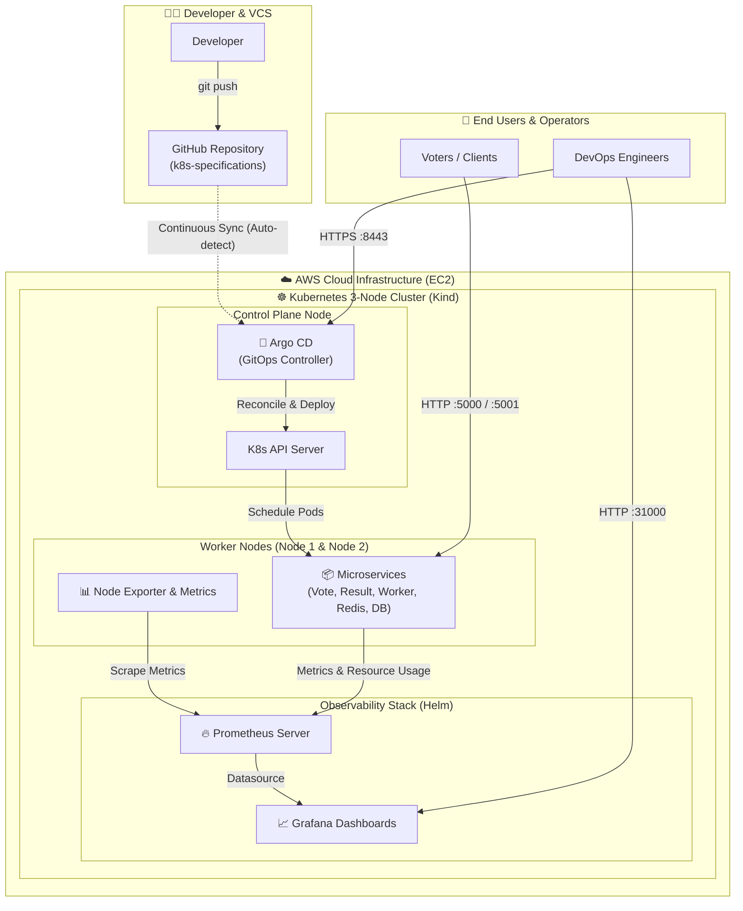
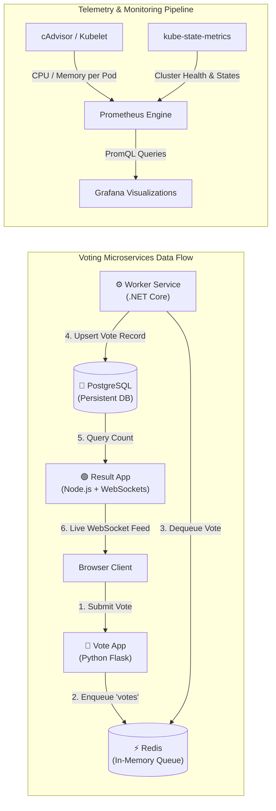

# Cloud-Native Microservices Deployment with Kubernetes, GitOps & Observability

[](https://kubernetes.io/)
[](https://argoproj.github.io/cd/)
[](https://prometheus.io/)
[](https://grafana.com/)
[](https://aws.amazon.com/ec2/)

An enterprise-ready GitOps deployment of a distributed microservices voting application on an **AWS EC2 multi-node Kubernetes cluster** using **Kind**, automated declarative continuous delivery with **Argo CD**, and end-to-end observability using **Prometheus and Grafana**.

---

## 🏛️ High-Level Design (HLD)

The HLD illustrates the end-to-end GitOps workflow, infrastructure hosting on AWS, container orchestration via Kind, and cluster monitoring:



---

## 🔬 Low-Level Design (LLD)

The LLD shows the microservices data pipeline and metric telemetry scraping:



---

## 🚀 Key Features & Highlights

1. **Declarative GitOps with Argo CD**: 
   - Zero manual `kubectl apply` in production. Any change pushed to GitHub automatically synchronizes with the cluster in real time.
   - Automated self-healing and drift detection against unwanted manual cluster changes.

2. **Distributed Microservices Pipeline**:
   - Multi-language polyglot architecture: Python (Front-end), .NET Core (Worker), Node.js (Real-time Analytics), Redis (Message Broker), and PostgreSQL (Persistent Store).

3. **Multi-Node Kubernetes (Kind) on AWS**:
   - Emulates an enterprise 3-node Kubernetes cluster (1 control plane + 2 worker nodes) inside an AWS EC2 instance.

4. **Production-Grade Observability**:
   - Deployed using **Helm** with the official `kube-prometheus-stack`.
   - Real-time Prometheus metrics scraping across pods, nodes, and containers.
   - Custom Grafana dashboards visualizing CPU usage, memory consumption, network in/out, and pod health.

---

## 🛠️ Step-by-Step Setup Guide

### 1. Prerequisites & EC2 Setup
- **Recommended Instance:** AWS EC2 `c7i-flex.large` (4GB) or `m7i-flex.large` (8GB), 30GB EBS gp3 storage.
- **Security Group Ingress Ports:** `22` (SSH), `5000` (Vote), `5001` (Result), `8443` (Argo CD), `9090` (Prometheus), `31000` (Grafana).

### 2. Install Docker, Kind & Kubectl
```bash
# Update and install Docker
sudo apt update && sudo apt install -y docker.io
sudo usermod -aG docker $USER && newgrp docker

# Install Kind (Multi-Architecture script)
./kind-cluster/install_kind.sh

# Install Kubectl
./kind-cluster/install_kubectl.sh
```

### 3. Launch 3-Node Kubernetes Cluster
```bash
kind create cluster --config=kind-cluster/config.yml
kubectl get nodes
```

### 4. Install and Configure Argo CD
```bash
kubectl create namespace argocd
kubectl apply -n argocd -f https://raw.githubusercontent.com/argoproj/argo-cd/stable/manifests/install.yaml

# Wait for pods and get initial admin password
kubectl wait --for=condition=ready pod -l app.kubernetes.io/name=argocd-server -n argocd --timeout=300s
kubectl get secret -n argocd argocd-initial-admin-secret -o jsonpath="{.data.password}" | base64 -d && echo

# Expose Argo CD Server
kubectl port-forward -n argocd service/argocd-server 8443:443 --address=0.0.0.0 &
```

### 5. Deploy Observability Stack (Prometheus & Grafana)
```bash
# Install Helm 3
curl -fsSL -o get_helm.sh https://raw.githubusercontent.com/helm/helm/main/scripts/get-helm-3
chmod 700 get_helm.sh && ./get_helm.sh

# Deploy Kube-Prometheus-Stack
helm repo add prometheus-community https://prometheus-community.github.io/helm-charts
helm repo update
kubectl create namespace monitoring

helm install kind-prometheus prometheus-community/kube-prometheus-stack --namespace monitoring

# Expose Dashboards
kubectl port-forward svc/kind-prometheus-kube-prome-prometheus -n monitoring 9090:9090 --address=0.0.0.0 &
kubectl port-forward svc/kind-prometheus-grafana -n monitoring 31000:80 --address=0.0.0.0 &
```

---

## 📈 PromQL Monitoring Queries

| Metric | PromQL Query |
| :--- | :--- |
| **Pod Memory Usage** | `sum (container_memory_usage_bytes{namespace="default"}) by (pod)` |
| **Pod CPU Usage** | `sum (rate (container_cpu_usage_seconds_total{namespace="default"}[1m])) by (pod)` |
| **Network Received (In)** | `sum (rate (container_network_receive_bytes_total{namespace="default"}[1m])) by (pod)` |
| **Network Transmitted (Out)** | `sum (rate (container_network_transmit_bytes_total{namespace="default"}[1m])) by (pod)` |

---

## 💼 Resume & Portfolio Description

### Project Title
**Automated Cloud-Native Microservices Deployment on AWS with Kubernetes, Argo CD, and Observability**

### Description
Architected and automated the end-to-end GitOps deployment of a distributed polyglot microservices application on AWS EC2 utilizing a multi-node Kubernetes (Kind) cluster. Automated CI/CD reconciliation using Argo CD, achieving zero-touch declarative deployments and automated self-healing. Implemented full-stack observability with Helm, Prometheus, and custom Grafana monitoring dashboards for real-time telemetry, pod resource analysis, and cluster health monitoring.

### Core Technologies
- **Infrastructure:** AWS EC2, Linux (Ubuntu), Docker
- **Orchestration:** Kubernetes (v1.30), Kind (Multi-node cluster)
- **Continuous Delivery:** Argo CD (GitOps, Declarative Sync, Drift Detection)
- **Observability:** Prometheus, Grafana, PromQL, Alertmanager, Node Exporter, Helm 3
- **Microservices Stack:** Python (Flask), .NET Core, Node.js, Redis, PostgreSQL

---

## 👤 Author
- **Ankush** ([GitHub](https://github.com/ankushp965))
